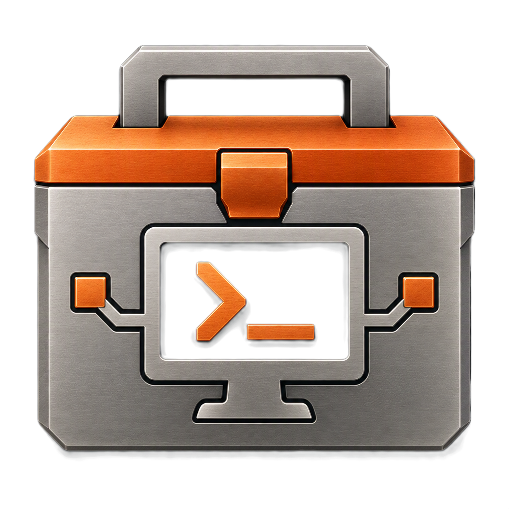

<p align="center">
  
</p>

# Endpoint Toolbox

The scripts in this tree can be used individually or through the [Windows desktop application](Desktop/README.md).

**Known issue:** the packaged `EndpointToolbox.exe` can fail at **Connect / reconnect** with a window-handle error. Until that is fixed, start the app from the shortcut or `Start-EndpointToolboxUI.ps1`, which keeps a PowerShell console visible and signs in normally. Details and candidate fixes are in the [EXE sign-in analysis](Desktop/Packaging/README.md).

For step-by-step instructions and a guide to each task, see the [Endpoint Toolbox user guide](HELP.md).

The desktop application covers all 29 scripts in the root and service subfolders. It provides forms, in-app prompts, reports, per-target outcomes, and an embedded remote PowerShell workspace. Its **Home / Graph connection** page signs into the shared Graph worker and checks the live connection and active PIM roles. Graph tasks recheck access before their business script starts; scripts retain their original CLI authentication behavior. See [authentication and dependencies](Desktop/README.md#authentication-and-dependencies).

Administrators can deploy a single [shared defaults JSON](Desktop/EndpointToolbox.defaults.json) for tenant, workspace, report folder and other preferences. Users can override these in Settings; all per-user preferences now share one sectioned `settings.json`, with automatic migration of existing files. See [universal settings and deployment defaults](Desktop/README.md#universal-settings-and-deployment-defaults).

**Inventory > All Cloud PCs** lists Windows 365 Cloud PC records and provisioning status, including records that are not yet provisioned. It requires existing `CloudPC.Read.All` or `CloudPC.ReadWrite.All` consent and uses the Graph beta API; see the [workflow notes](Desktop/README.md#all-cloud-pcs) for permissions and limitations.

**Inventory > Device investigation dashboard** provides a read-only view of matching Intune, Entra and Autopilot records. Search by exact device name, serial number or Intune-associated user UPN. See the [dashboard instructions](Desktop/README.md#device-investigation-dashboard) for permissions, identity matching and limitations.

**Apps and assignments > Why did this Win32 app not install?** investigates one exact device and app, showing reported deployment/user-context rows, raw errors, last sync, current assignments/filters and suggested checks. It is read-only and does not claim to determine effective targeting or a definitive cause. See the [investigation instructions](Desktop/README.md#win32-app-installation-investigation) for permissions, temporary fleet-report handling and limitations.

**Groups > View Entra group membership** replaces the separate member-list and device-only tasks. Enter an exact group name or object ID to return all member types; optionally enable **Expand nested groups** for a flat, deduplicated list of direct and indirect members. The read-only [standalone script](entra/Get-EntraGroupMembers.ps1) supports the same options. See the [workflow instructions](Desktop/README.md#view-entra-group-membership) for permissions, export and Graph API limitations.

**Groups > Add users or devices to Entra group** replaces the separate user and device add tasks. [Add-EntraGroupMembers.ps1](entra/Add-EntraGroupMembers.ps1) is the new CLI entry point; pass explicit names or a list file. See the [add workflow instructions](Desktop/README.md#add-users-or-devices-to-an-entra-group).

**Groups > Remove users or devices from Entra group** supports previewing and removing direct memberships without deleting directory objects. See the [workflow instructions](Desktop/README.md#remove-users-or-devices-from-an-entra-group).

Tasks are grouped under sidebar category headings. Configure a task first, then use the separate Run & results workspace for live output and reports. The Win32 selection dialogs use rows/checkboxes while preserving each original script's matching, confirmation and selection rules.

**Device reports > Remediation and platform script status** loads a searchable list of Intune remediations and platform scripts before the report runs. The operator chooses one script to export its latest per-device run states. It uses existing `DeviceManagementScripts.Read.All` consent and does not execute or change the selected script; see the [desktop workflow notes](Desktop/README.md#remediation-and-platform-script-status).

**Inventory > User sign-in history** shows a first page of individual interactive and non-interactive events for a rolling 1–30 day window, with **Load more** and **Retrieve all** actions. It retains existing authentication and scopes. See the [user guide](HELP.md#user-sign-in-history) for paging, incomplete results, access requirements and Graph beta limitations.

**Device reports > Expedited quality updates** lets you load and search Intune policies before running a read-only status report. See the [desktop workflow notes](Desktop/README.md#expedited-quality-updates).

**Device reports > Windows Update for Business reporting** queries your Azure Log Analytics workspace directly for security compliance, device/build details, update failures, error codes, restarts, trends and exact KB investigation. Save the workspace GUID under **Settings > WUfB**. It requires separately installed **Az.Accounts 5.0+** and Azure query access, not CSV imports. A compatible existing Azure user session is reused. Home Graph is unnecessary by default; the optional, default-off **Resolve missing computer names using Graph** fills missing names by Entra device ID using an existing same-tenant session with **Device.Read.All** consent. It preserves reported names and adds resolution provenance without changing device telemetry policy. Use only if your security/privacy policy permits names in reports and exports. See the [reporting rules and limitations](Desktop/README.md#windows-update-for-business-reporting).

The business scripts no longer contain the prior UI-event hooks: 11 remain unchanged by the desktop work. Presentation integration lives under Desktop. The two Win32 deployment scripts have been merged, as requested, into [Intune\Assignments\Get-Win32AppDeploymentStatus.ps1](Intune/Assignments/Get-Win32AppDeploymentStatus.ps1); the duplicate under Devices was removed. It searches partial names/patterns, allows one or many selections, and exports device details, per-device summaries and user status. [Win32 app deletion](Intune/Apps/Remove-Win32App.ps1) reports per-app failures, continues the batch without bypassing dependency blocks, and writes a per-run outcome CSV (`-OutputPath`, TEMP by default). [Intune device sync](Intune/Devices/Invoke-IntuneSync.ps1) processes up to 100 device names at a time and waits 90 seconds between batches. Deployment, sync, device usage and assignment-listing scripts retain compact outcome counters for desktop activity summaries. The other retained business-script change is the protected cleanup logging configuration below.

The desktop app saves compact master and per-task activity logs under `%LOCALAPPDATA%\EndpointToolbox\Logs`, with 30-day retention and an **Open activity logs** button. Remote logging captures only connection/disconnection metadata, device and outcome, never commands or returned content. See [retention and exports](Desktop/README.md#retention-and-exports) for count semantics, privacy and report handling.

The Remote workspace includes a friendly-name **Saved commands** dropdown backed by [RemoteCommands.json](Desktop/RemoteCommands.json). Selection fills the editable command box for review; only **Run on endpoint** executes it. See [Remote workspace](Desktop/README.md#remote-workspace) for command customization and cleanup precautions.

Remote connections prompt for device administrator credentials, independently of Graph sign-in.

The **Settings > Remote** tab optionally saves a DNS suffix for the explicit Explorer UNC handoff. Leave it blank to use the computer name as entered; a suffix is appended only to an unqualified name.

Start the app from PowerShell 7:

```powershell
pwsh.exe -NoProfile -STA -File .\Desktop\Start-EndpointToolboxUI.ps1
```

For a per-user desktop shortcut:

```powershell
.\Desktop\Install-EndpointToolboxShortcut.ps1
```

## Create direct reports groups

Under **Groups > Create direct reports group**, supply the manager's exact Entra display name or UPN. The app resolves the manager's object ID and creates a dynamic, non-mail-enabled security group named `Entra.Users.DirectReports.<FirstLast>` using Entra's `givenName` followed by `surname`, with whitespace removed, not the literal display name. For example, `Johnson, Kurt` with first name `Kurt` and last name `Johnson` becomes `Entra.Users.DirectReports.KurtJohnson`. Both name fields must be populated; missing fields stop creation.

The rule is `Direct Reports for "<manager-object-id>"`. **Entra includes the manager as well as their immediate reports**; nested reports are not included. The description uses `Dynamic direct reports group for <manager display name>. Created by <creator UPN> on <yyyy-MM-dd>.` with the UTC creation date. Membership is evaluated asynchronously using Entra's manager relationships; group creation does not mean membership processing has finished.

Use **Preview only (WhatIf)** to inspect the generated name, rule and description without creating anything. Real runs request confirmation. Ambiguous names require a unique UPN. Existing group names block creation; the workflow never updates existing groups or retries uncertain requests automatically. Check Entra before retrying a failed or cancelled creation.

The [standalone script](entra/New-EntraDirectReportsGroup.ps1) supports the same behavior:

```powershell
.\entra\New-EntraDirectReportsGroup.ps1 -Manager 'manager@example.invalid' -WhatIf
```

Requires existing delegated `User.Read.All` and `Group.ReadWrite.All` consent, permission to create dynamic security groups (typically Groups Administrator), and appropriate Entra ID P1 licensing for unique dynamic-group members. Home does not request these permissions automatically. CLI use reuses the current delegated Global Graph connection, or signs in with existing `.default` consent without specifying a different tenant.

## Microsoft 365 Apps Cloud Update

**Device reports > Microsoft 365 Apps Cloud Update** integrates [Get-M365CloudUpdateReport.ps1](entra/Get-M365CloudUpdateReport.ps1) for Monthly Enterprise Channel reporting. It requires separately installed **MSAL.PS** and its own interactive Office sign-in, independent of Home Graph. The desktop saves the three CSVs to **TEMP** by default (not the repository), displays the portal-style device rows first, and offers release and rollout statistics through the grid's dataset selector. The top card shows run status and timing only. The export folder is configurable; **Do not save CSV reports** keeps results in the app only.

Optional **Include rollout group membership (Graph)** adds a **Group** column to the grid and portal-style CSV. First save one or more exact Entra group display names under **Settings > Cloud Update**, one per line. The list is empty by default. Standalone use requires `-WaveGroupNames` when enabling `-IncludeWaveGroups`. Connect on Home first in the same tenant as Office, with existing `Group.Read.All` and `Device.Read.All` consent. Multiple matching groups are separated by semicolons; ambiguous or missing computer-name matches remain Unknown. The Office-reported wave is not changed. Default runs remain unchanged without `-IncludeWaveGroups`.

Missing or ambiguous configured group names produce warnings without blocking CSV export. Known memberships are retained; unmatched rows stay Unknown until all groups can be resolved. The summary explicitly marks group correlation incomplete.

The script uses undocumented Office portal APIs that may change without notice; service authorization is enforced by Office. See [desktop prerequisites, configured groups and correlation limits](Desktop/README.md#microsoft-365-apps-cloud-update).

## Cleanup logging configuration

The Entra cleanup script (`Intune/Devices/Remove-EntraDevice.ps1`) can optionally send the result of each **real** run to a logging endpoint, such as a webhook-triggered automation runbook that writes to a list or table. This is off by default. To turn it on, set the endpoint URL in the current user's process environment as `ENDPOINT_TOOLBOX_LOGGING_WEBHOOK`, using a protected credential or configuration process. The application inherits the environment of its launcher.

If the variable is not set, the script still runs normally: nothing is sent remotely, and a message says so. Use `-ExportCsv` (the **Save report** option in the app) to keep a local copy of the results.

Treat the URL as a secret, because webhook URLs usually carry their own access token. Do not put it in source control, shortcuts, screenshots, command history, or application logs, and rotate it if it is ever exposed. Preview (`-WhatIf`) never submits remote logging.

The script posts JSON in the form `{ "rows": [ ... ] }`, in batches of up to 200 rows, with an explicit UTC offset on timestamps. Successful submission does not prove the receiving service persisted the data. A reference runbook that accepts this payload is published separately; see the companion repository linked from this project.

## License

Copyright (C) 2026 Eric Hebert

This program is free software: you can redistribute it and/or modify it under the terms of the GNU General Public License as published by the Free Software Foundation, either version 3 of the License, or (at your option) any later version.

This program is distributed in the hope that it will be useful, but WITHOUT ANY WARRANTY; without even the implied warranty of MERCHANTABILITY or FITNESS FOR A PARTICULAR PURPOSE. See the [GNU General Public License](LICENSE) for more details.
